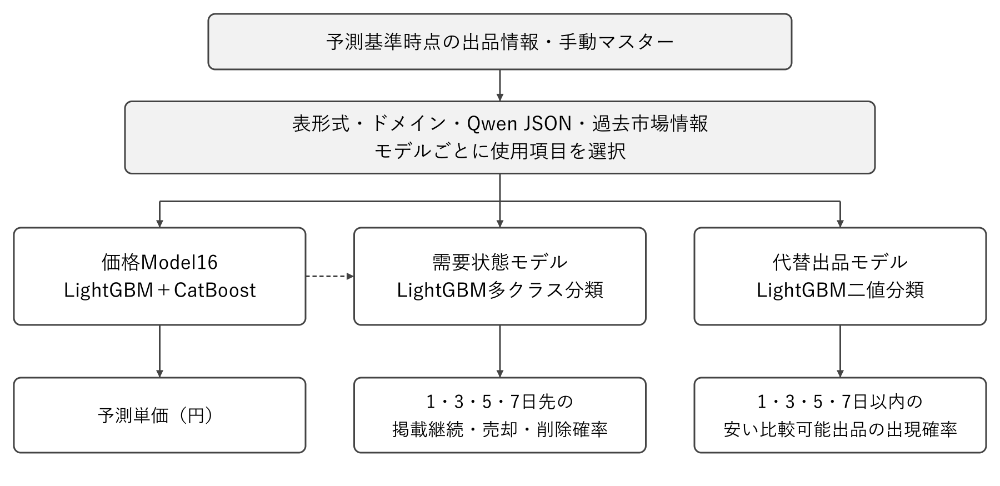

# 研究内容

## 6.1 開発したAI全体のシステム構成

本研究では、チケット二次流通市場における価格と出品状況を分析するため、価格予測、需要状態予測、代替出品予測を組み合わせたシステムを開発した。価格予測にはModel16を使用し、需要状態と代替出品については、それぞれ独立した分類モデルを構築した。本章における3モデルとは、この価格モデル、需要状態モデル、代替出品モデルを指す。

3モデルは同じ内容を別の方法で予測するものではない。価格モデルは公演条件や取引条件に対応する売却済み表示単価を推定し、需要状態モデルは出品中のチケットが一定期間後にどの状態になるかを予測する。代替出品モデルは、一定期間内に比較可能で安い新規出品が確認されるかを予測する。これにより、価格の水準、対象出品の売却・削除リスク、安い別の出品を待つ可能性を分けて扱う。

システムは、データ保存、入力整理、特徴量作成、モデル推論、結果保存の各処理から構成される。データ保存では、アーティスト別のマスターCSV、日付ごとの保存版、取得範囲や状態確認を示す観測記録を管理する。手動で収集したアーティスト・会場・公演の情報は、別のマスターとして結合する。

特徴量作成では、公演日、会場、定価、枚数、券種、名義、受渡方法等の表形式情報に加え、説明文から抽出した取引条件と過去の市場情報を使用する。自由記述文は、正規表現による条件抽出とQwenによるJSON意味抽出によって整理する。3モデルで利用する意味情報は共通性を持つが、価格モデルと状態・代替モデルでは使用項目や保存形式が異なるため、モデルごとの入力仕様に合わせて処理する。

価格モデルの予測値は、需要状態モデルの価格基準としても利用する。対象の表示単価と予測価格の比率等を入力することで、単純な金額だけでなく、公演条件や取引条件に対する価格水準を表現する。一方、代替出品モデルは対象価格と将来の比較可能な出品との関係を扱うものであり、需要モデルの出力をそのまま代替の正解として使用することはしない。

図6-1は予測時の情報の流れを示す。後日の売却・削除・新規出品の観測は、学習時の正解作成と評価にだけ使用し、予測基準時点の説明変数へ混ぜない。3モデルを利用する際は、共通のチケットIDと予測基準日時により結果を対応付ける。

買い時判断は、これらの出力を利用する応用層として区別する。価格モデルの出力、売却・削除の確率、安い代替出品の出現確率を参照し、待つ場合と今購入する場合の判断材料を作る。ただし、3種類の予測を組み合わせたことだけで、実際に安く購入できることが保証されるわけではない。

## 6.2 ネットワークアーキテクチャの詳細

本システムは、すべての処理を一つのニューラルネットワークとして同時に学習する構成ではない。言語モデルによる説明文の特徴抽出と、勾配ブースティング決定木等による予測を段階的に接続する。本節では、この情報処理の接続関係をアーキテクチャとして説明する。

### 6.2.1 説明文の意味抽出部分

意味抽出にはQwen2.5-7B-Instructを使用する。確認した保存済み設定では、28層のデコーダ型Transformer、隠れ状態3,584次元、28個の注意ヘッドおよび4個のキー・バリューヘッドを持つ。これらは事前学習済みモデルの構成であり、本研究で独自に設計した層数ではない。

出品説明文と抽出項目を示す指示を入力し、座席階層、列の位置、当選経路、名義、本人確認、配布方式、見切れ条件等を生成させる。生成結果は文字列のまま回帰器へ渡すのではなく、許可したカテゴリや数値に正規化したJSON意味特徴へ変換する。不明な内容を価格から推測して補うことはせず、不明または抽出失敗として区別する。

Qwenは4ビット量子化して推論し、同じ説明文の抽出結果を再利用する。価格ラベルを与えた回帰用LoRA追加学習や、Qwenの価格推定値の入力はModel16では採用していない。したがって、保存記録のQwen価格予測不使用という設定と、Qwen由来の意味特徴を使用する構成は両立する。

### 6.2.2 価格モデルの入力と回帰候補

保存済みModel16は、数値71項目、カテゴリ25項目の計96項目を入力候補として保持している。これには公演・取引条件、過去市場の集計値、正規表現による特徴、Qwen意味特徴等を含む。数値項目を欠損補完し、カテゴリをOne-Hot展開した最終LightGBMの入力は、欠損指標を含め742列であった。展開後の列数はカテゴリ集合に依存するため、交差検証の各分割や別の学習対象で常に742列になるわけではない。

LightGBMでは、対数価格をL1損失で学習する候補と、非対数価格に対して逆価格重みを付ける候補を比較した。決定木を順に加算して予測を改善する構成であり、ニューラルネットワークの隠れ層数に対応するものではない。保存済みの採用LightGBMは、木の本数2,664、最大深さ10、葉数の上限95、学習率約0.0170である。

CatBoostでは、同じ公演・取引・意味情報を使用し、カテゴリをモデル内で処理する。非対数価格に比例する尺度を目的変数として、MAEを重視するOrdered boostingを用いた。保存済みの採用モデルは、反復回数3,047、深さ10、学習率約0.0261である。これらの設定は価格モデルの探索と学習によって得られたもので、後述する状態分類モデルの固定設定とは異なる。

### 6.2.3 BERTによる独立した回帰候補

説明文全体の文章表現を比較するため、日本語BERTも使用した。確認した事前学習済みBERTは12層、隠れ状態768次元、12個の注意ヘッドを持つエンコーダ型Transformerである。説明文とタグから768次元のベクトルを作成し、PCAで16、32、48、64、96次元へ圧縮する候補を比較した。

圧縮後のベクトルを標準化し、Ridge回帰によって対数価格を予測する。BERT自体の価格ラベルによる追加学習は行わず、PCA、標準化、Ridge回帰は学習側だけで学習する。BERTベクトルを数百列のままLightGBMへ直接連結する構成ではない。

BERT回帰は独立した比較候補であり、現在の保存済みModel16では最終重みが0である。このため、採用モデルの価格推論でBERTを必須の処理として実行する必要はない。

### 6.2.4 価格予測の統合部分

比較した4候補の予測をすべて円単位へ復元し、非負で総和が1となる重みを付けて統合する。予測対象の価格帯やチケットごとに予測器を切り替えず、全対象に同じ重みを適用する。

現在の保存済みモデルの価格出力は、概ね次式で表される。

y_hat = 0.60154 × f_LGBM(x) + 0.39846 × f_CatBoost(x)

ここで、f_LGBM(x)は対数LightGBMの出力を円単位へ戻した価格、f_CatBoost(x)はCatBoostの円単位の価格である。MAPE重視のLightGBMとBERT回帰も学習・比較したが、この保存モデルでは重み0である。Qwenの役割は各回帰器に渡す意味特徴の生成であり、この式にQwen単独の価格予測を加算する項は存在しない。

### 6.2.5 需要状態モデル

需要状態モデルは、1日、3日、5日、7日の各期間に対して独立したLightGBM多クラス分類器を持つ。各分類器は掲載継続、売却確認、削除・取下げ確認の3状態を出力する。4期間でパラメータを共有する一つの多出力ニューラルネットワークではない。

修正版の保存モデルでは、数値53項目とカテゴリ16項目の計69項目を使用した。対象価格、Model16価格との比率、公演までの日数、出品からの経過日数、現在の出品数、安い出品の件数、過去の新規・売却・削除件数、説明文の意味特徴等を含む。数値は学習側の中央値で補完し、カテゴリは学習側の補完とOne-Hot展開を行う。

各期間の分類器は、反復回数700、学習率0.035、最大深さ9、葉数上限48、葉に必要な最小サンプル数40を用いる。生の多クラス出力を確率へ変換し、各期間において3状態の合計が1になるように扱う。

さらに、期間が長くなるほど売却・削除の累積リスクが小さくならないよう、期間間の確率を共同で整合させる。単に売却確率と削除確率の最大値を別々に取って足すのではなく、合計リスクと原因別リスクを制約の下で調整する。修正版の保存モデルでは温度係数は1.0であり、11月11日の正解に合わせた確率較正は行っていない。

### 6.2.6 代替出品モデル

代替出品モデルは、1日、3日、5日、7日の各期間について、比較可能で安い出品が確認されるかを予測するLightGBM二値分類器を持つ。修正版の保存モデルでは、数値35項目とカテゴリ16項目の計51項目を使用した。

入力には公演・券種・名義・枚数・意味特徴に加え、対象の表示単価、現在の市場価格の分布、出品件数、過去の新規出品件数等を用いる。各分類器の設定は、反復回数650、学習率0.035、最大深さ8、葉数上限40、葉に必要な最小サンプル数45である。

各期間の出現確率は、期間の延長によって低くならないように整合させる。修正版の保存モデルでは追加のロジスティック較正器を設定せず、生の分類確率と期間方向の整合処理を用いている。確率が高いことは代替出品を確実に購入できることを意味しない。

## 6.3 学習プロセスとデータフローの詳細

### 6.3.1 保存版の固定と学習対象の分離

学習に使用する保存版、手動情報、意味特徴およびコードの版を固定する。価格モデルの売却済みレコードと、需要・代替モデルの予測基準時点に出品中のレコードは、目的が異なるため別に処理する。

本章の価格評価は9月7日保存版に対応するModel16の10,150行を参照する。需要・代替の更新学習では、11月4日09時49分51秒JSTを結果の締切とし、実際に保存された8時点の入力を使用した。したがって、3モデルのすべてを11月4日までの同じ行で一括学習したわけではない。価格Model16の重みは固定して利用した。

同一出品の重複と明示的なIDの対応関係を整理し、同じ物理的な出品を独立した多数の取引として扱わない。説明文が同じ別出品も、評価時のグループが学習側と検証側に分離しないように管理する。

### 6.3.2 説明変数の作成

価格学習では、売却済み限定、説明文、価格範囲、公演内分位点等のクレンジングを適用する。手動マスターを結合し、表形式情報、正規表現によるドメイン特徴、QwenのJSON意味特徴、対象の初回観測以前に確認された市場情報を作成する。

需要・代替では、予測基準時点までに確認できた出品情報を入力にする。対象価格や現在の市場価格を入力できるのは、価格そのものを未知の目的変数として予測するのではなく、その価格で出品されているチケットの将来状態や代替出現を予測するためである。

Model16の価格を需要モデルへ渡す処理では、Model16自身の学習対象に含まれた売却済みレコードに保存済みの未学習行予測を対応付け、それ以外のレコードには固定済みの価格モデルを適用する。これにより、価格モデルの学習対象に対する当てはめ値と、学習対象外への予測値を区別して価格特徴を作成する。

### 6.3.3 後日の観測による正解の作成

説明変数を固定した後、後日の観測を結合して期間別の正解を作る。需要の正解は掲載継続、売却確認、削除・取下げ確認であり、終了理由が不明なものを売却と推測しない。出品が表示から消えたことだけで、その価格で売れたとは判定しない。

需要ラベルの作成では、後日の最終CSVだけを参照すると、その後売却された出品の過去の掲載継続が不明になる場合があった。そこで、期間末から2時間以内に当該IDが出品中であると確認されたAPI観測も参照し、根拠がある不明ラベルだけを掲載継続へ復帰させた。既知の売却・削除ラベルは変更せず、学習締切後の記録も使用しない。2時間は観測の時間幅に対する近似であり、期間末の瞬間を連続観測したという意味ではない。

代替出品の正解は、同じ公演と枚数、券種、名義、確認できる座席条件等を満たし、対象価格より一定額以上安い新しい出品が期間内に観測されたかで定義する。安いことの基準は2,000円と対象価格の5%の大きい方とする。価格や条件が後に更新される可能性があるため、初回観測時の情報が確認できるかも調べる。

期間が満了していない行、正解を確定できない行、公演終了により比較できない行は、その期間の確定した学習対象に含めない。正解不明を非売却や代替非出現と置き換えることはしない。

### 6.3.4 価格モデルの学習と統合

価格モデルは外側5分割・内側4分割のグループ交差検証で学習する。外側の検証行を残し、内側の学習データだけで欠損補完、カテゴリ変換、設定探索、BERTの次元圧縮および統合重みを決定する。

Optunaによる探索では、対数LightGBMとCatBoostを円単位のMAEで比較し、MAPE重視のLightGBMをMAPEで比較する。BERT回帰では内側のMAEに基づいてPCAの次元数と正則化を選ぶ。統合はMAEを主指標とし、最良MAE単体候補に対してMAPEの悪化が0.10パーセントポイントを超えない制約を設ける。

外側の未学習行予測を集計して候補を比較し、その後、採用構成を全学習対象で学習して保存する。最終モデルの重みを外側の全検証行へ後から一律に当てはめ直した値を、入れ子型評価の結果として使用することはしない。

### 6.3.5 需要・代替モデルの更新学習

需要と代替は、物理的に同一の出品と重複説明文のグループを保持した4分割の交差予測を作成し、各期間の正解がある全行で最終学習する。グループごとの分割は期間とモデルをまたいで対応させ、同じグループが一方のモデルで学習済み、他方で未学習という不整合を抑える。

修正版で使用した期間別の学習行数を表6-1に示す。同じ出品を複数の実保存時点から予測した行を含むため、一意なチケット数とは異なる。また、期間ごとに観測可能な正解が異なるため、すべての期間で同じ行数になるわけではない。

表6-1 需要・代替モデルの学習行数

| 予測期間 | 需要状態 | 代替出品 |
|---|---:|---:|
| 1日 | 24,424 | 7,343 |
| 3日 | 19,915 | 11,641 |
| 5日 | 20,199 | 12,636 |
| 7日 | 19,461 | 13,475 |

この交差予測は学習内診断と後段の方針学習のためのもので、時間順を保った将来検証の代わりではない。複数の保存時点を使っていても、8時点が統計的に独立した8回の実験になるとは解釈しない。

### 6.3.6 学習済みモデルの利用と再開

モデルの保存時には、重み、特徴量の選択、前処理、入力の版、学習・評価の記録を対応付ける。更新時の候補は現行モデルと別の領域へ保存し、比較前に現行の重みを上書きしない。

同じ入力とコードに対して完了した工程は、保存済みのハッシュを確認して再利用する。説明文の意味抽出やBERT埋め込み等も、価格ラベルを学習していない互換な特徴に限って再利用する。特徴生成を省略できることと、価格回帰器や分類器を追加データなしで更新したことは区別する。

修正版の学習では、確認済みの特徴量を保持し、根拠付きの需要ラベルを作り直して再学習した。入力、既知の正解、保存モデル等の整合を確認し、計算時間の短縮のために予測期間や交差予測の回数を減らすことはしていない。

## 6.4 3モデルの出力について

### 6.4.1 価格モデルの出力

価格モデルは、公演条件と取引条件に対応する1枚当たりの予測価格を円単位で出力する。この値は売却済み表示価格の予測であり、必ず売れる価格、販売者が受け取る金額、購入者の手数料込みの総支払額ではない。

対象の表示単価と予測値を比べることで、モデルが学習した条件に対する価格水準を確認できる。ただし、価格差だけを根拠として売却の速さや将来の値下がりを判断しない。

### 6.4.2 需要状態モデルの出力

需要状態モデルは、各チケットについて1日、3日、5日、7日先の掲載継続確率、売却確認確率、削除・取下げ確認確率を出力する。各期間の3確率の合計は1であり、1件当たり計12個の状態確率を持つ。

売却確認と削除・取下げ確認は異なる状態である。削除には出品者都合の取下げや他媒体での取引等も含み得るため、削除確率をそのままチケテンでの売却確率へ加算しない。両者を加えた値は、定義した終了状態に移るリスクとして扱う。

### 6.4.3 代替出品モデルの出力

代替出品モデルは、1日、3日、5日、7日以内に、定義した条件を満たす安い出品が現れる確率を出力する。例えば、対象の表示単価が59,000円であれば、5%に当たる2,950円は2,000円より大きいため、価格条件は56,050円以下となる。これに加え、公演・枚数・券種・名義・座席条件等の比較条件を満たす必要がある。

出現確率が高くても、その出品が長時間残ることや、購入者が入手できることまでは予測していない。初回観測で確認できない出品を含む不完全なデータについても、精度が確認できたとは扱わない。

### 6.4.4 予測出力の読み方

各出品について、予測単価（円）、期間別の状態確率（掲載継続・売却確認・削除確認）、期間別の代替出現確率を保存する。対象出品の掲載継続と代替の出現は別の事象であり、両方の確率が高くても矛盾しない。確率が高くても、出現や購入が保証されるわけではない。

買い時判断に応用する場合も、各モデルの予測値、方針が選んだ行動、その後の観測結果を区別する。公開資料には出品単位の予測記録を含めない。

## 6.5 開発したAIの検証について

### 6.5.1 検証対象と指標の分離

価格モデルの誤差と、需要・代替モデルの分類確率は性質が異なる。そのため、同じ正解率だけで3モデルを一括評価せず、各目的に対応する指標を用いた。価格にはMAE、MAPE、RMSE、決定係数等を使用し、需要と代替にはLog loss、Brier score、ROC-AUC、PR-AUC等を用いる。

学習に含めなかったグループに対する交差予測と、学習締切後の未使用期間での検証も区別した。価格Model16の入れ子型グループ交差検証と、需要・代替の更新学習内診断は、同一の検証方法ではない。

### 6.5.2 価格モデルの交差検証結果

10,150行の売却済み表示価格に対する外側交差検証の結果を表6-3に示す。各行に対応する未学習行予測を用い、比較候補と固定重み統合を同じ母集団で評価した。

表6-3 価格モデルの交差検証結果

| 回帰候補 | MAE（円） | MAPE（%） | 決定係数 |
|---|---:|---:|---:|
| 対数LightGBM | 5,952.8 | 26.15 | 0.7391 |
| MAPE重視LightGBM | 6,780.0 | 25.34 | 0.6579 |
| CatBoost | 6,058.1 | 27.28 | 0.7470 |
| BERT・PCA・Ridge | 12,095.1 | 55.55 | 0.2439 |
| 固定重み統合 | 5,871.5 | 26.10 | 0.7508 |

固定重み統合はMAEが最も小さく、正解の±20%以内に収まる割合は約59.96%であった。一方、MAPEのみではMAPE重視のLightGBMの方が小さく、すべての指標で統合モデルが最良になったわけではない。主指標をMAEとして選ぶことと、補助指標の差を併記することを分けて扱った。

この結果はクレンジング後の表示価格に対するグループ交差検証であり、将来のすべての公演や未観測条件に同じ精度が得られることを保証しない。公演内分位点による対象選別、保存された説明文と手動情報の時点、候補選択後の未使用テストの必要性を考慮して解釈する。

### 6.5.3 需要ラベルの修正と同一条件での再比較

需要状態モデルでは、後日の最終状態だけで正解を作る処理が、過去に掲載継続していた出品を不明として落とす偏りを確認した。日時付きの出品中観測を利用して不明ラベルを修正し、説明変数と既知の売却・削除ラベルを変えずに再学習した。

修正後のモデルを11月4日の入力に適用し、11月11日のCSVで確認可能な結果と比較した。保存時刻の由来が確定していないため、そのまま扱う場合と9時間加算する場合の両方で正解が一致する行だけを評価した。したがって、これは条件を限定したCSV照合であり、観測記録が完全な将来検証ではない。

修正前後の評価対象と正解ラベルを固定した結果を表6-4と表6-5に示す。

表6-4 需要の部分検証における正解率（%）

| 期間 | 評価行数 | 修正前 | 修正後 | 常に掲載継続 |
|---|---:|---:|---:|---:|
| 1日 | 2,424 | 69.5 | 94.9 | 94.9 |
| 3日 | 2,681 | 62.6 | 85.8 | 85.8 |
| 5日 | 2,708 | 60.8 | 84.2 | 84.9 |
| 7日 | 2,785 | 58.3 | 81.1 | 82.6 |

表6-5 需要の部分検証におけるLog loss

| 期間 | 修正前 | 修正後 | 学習クラス比率の一定出力 |
|---|---:|---:|---:|
| 1日 | 0.872 | 0.271 | 0.233 |
| 3日 | 1.188 | 0.526 | 0.503 |
| 5日 | 1.269 | 0.596 | 0.521 |
| 7日 | 1.455 | 0.660 | 0.572 |

Log lossは小さいほど良く、修正後は全期間で改善した。しかし、1日先の評価対象では最大確率クラスがすべて掲載継続となり、33件の売却確認例を売却クラスとして検知できなかった。また、将来の正解に合わせていない学習時のクラス比率を一定出力する予測よりも、修正版のLog lossは大きかった。したがって、正解率の上昇だけで売却検知や需要判断が十分になったとは結論付けない。

さらに、11月11日は原因調査と修正後の再比較に使用した期間である。この結果を未使用の最終テストとは呼ばず、採用判断には別の未使用期間での確認が必要である。

### 6.5.4 代替出品の評価範囲

代替出品モデルでは、期間ごとの出現・非出現の正解がある行を使って学習内診断を行った。1日先の非出現例は2,630行であったが、7日先では250行であり、期間の延長に伴って正解の比率が大きく変わる。学習内の指標を示す場合も、このような対象数と正例・負例の偏りを併記する必要がある。

11月4日の入力に対する代替の予測は3,101チケットについて出力し、1日、3日、5日、7日の各期間を確認した。ただし、11月11日の最終CSVだけでは、期間途中に現れた代替の初回価格や、代替が存在しなかったことを確定できない場合がある。そのため、今回の照合では代替の将来精度を確定していない。

高い出現確率を多数出力したことや、学習内で良好な指標が得られたことを、将来の安い代替を正しく予測できた証拠としては扱わない。買い時方針の出力についても、実際の購入結果や利益改善を確認した評価とは区別する。

### 6.5.5 実装と出力の整合性の確認

予測精度とは別に、コードと出力の整合性を確認した。3状態の確率が有限で0から1の範囲に収まり、各期間で合計が1になること、代替の確率が期間方向に小さくならないこと、対象IDと予測期間に重複がないこと等を確認した。

需要の修正では、25,403行における108個の非目的変数列が修正前後で一致し、既知の正解も変わっていないことを確認した。学習済みモデル、入力、手動値および生成物のハッシュを検証し、保存CSVから指標を独立に再計算した。また、物理的な出品と説明文のグループに対応する交差予測の分割を照合した。

関連する将来検証の回帰テスト183件とラベル修復専用2件は成功した。ただし、テストの成功は処理の整合性を示すものであり、それだけで未知のデータに対する予測精度が高いことを証明するものではない。

以上から、価格モデルではクレンジング後の表示単価に対する交差検証結果を確認し、需要状態モデルではラベル生成の修正による改善と残る売却検知の課題を確認した。代替出品については推論と学習内診断を確認したが、将来精度の確定には至っていない。3モデルの完成度を同じ水準で扱わず、確認できた結果と未検証の範囲を分けて評価する。
